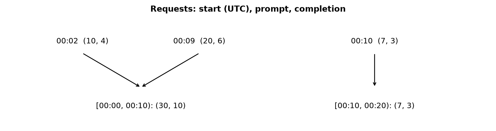
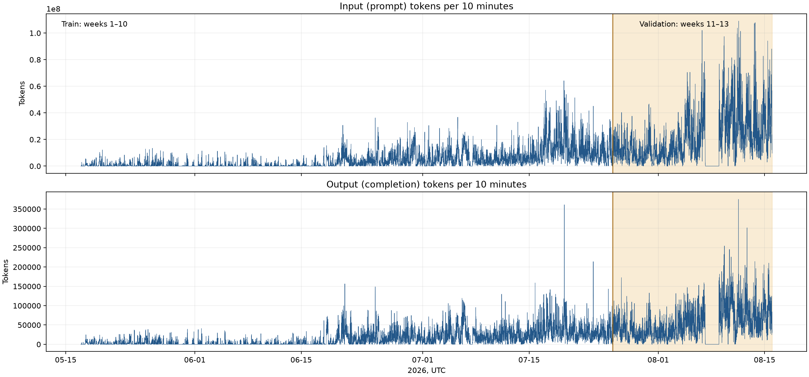

# FreeInference EDA: weeks 1–13

- Run: `/Users/nojonghyeon/.venvs/ts-freeinference/bin/python3 -m freeinference.eda` with `FREEINFERENCE_DATA_DIR` set to the prepared data.
- Revision: `bb26cf72c9c20f2b05f765d88548156a74d3c253`. Train: weeks 1–10; validation: weeks 11–13. Test is refused by the loader.
- Requests: 727,503; strictly completed adjacent step pairs: 718,615. Descriptive associations are not prediction results.

## Request aggregation

UTC 10-minute intervals are left-closed and right-open. Both token columns are summed and empty bins are zero-filled; the full 13-week interval is shown. Zero bins indicate no recorded requests, not evidence of continuous service availability.

## Definitions

Adjacent means consecutive numeric steps within the same released week and session, with previous end strictly before next start. Correlation is Pearson's r over request pairs. Finish reason and tool category belong to the previous step; each distinct category contributes once per pair, so multi-category pairs appear in multiple rows. `no tool` means no matching tool call.

A session is active from its first request start through its last request end, both inclusive; it includes gaps and the current session. Concurrent counts include spans across released weeks. This retrospective span uses the eventual last end and is not an online feature. Token distributions are request-weighted; n counts non-null completions and p10/p50/p90 are empirical quantiles. Categories outside the fixed public vocabulary are grouped to avoid exposing identifiers.

## Adjacent step completion correlation

| split | pairs | Pearson r |
| --- | --- | --- |
| train | 394306 | 0.15 |
| validation | 324309 | 0.14 |

## Previous finish reason → next completion

| split | finish | n | mean | p10 | p50 | p90 |
| --- | --- | --- | --- | --- | --- | --- |
| train | length | 68 | 2317.13 | 88.70 | 1458.00 | 8039.40 |
| train | other/missing | 19 | 407.53 | 57.60 | 414.00 | 827.60 |
| train | stop | 21893 | 543.90 | 55.00 | 210.00 | 1196.00 |
| train | tool_calls | 372326 | 357.06 | 43.00 | 133.00 | 794.00 |
| validation | length | 20 | 1903.25 | 98.00 | 1098.50 | 3887.30 |
| validation | other/missing | 4 | 2443.50 | 63.60 | 1935.50 | 5229.80 |
| validation | stop | 20300 | 682.18 | 71.90 | 297.00 | 1616.00 |
| validation | tool_calls | 303985 | 462.67 | 68.00 | 226.00 | 1006.00 |

## Previous step tool category → next completion

| split | category | n | mean | p10 | p50 | p90 |
| --- | --- | --- | --- | --- | --- | --- |
| train | *Build/Test | 12502 | 262.56 | 51.00 | 106.00 | 624.90 |
| train | *File Ops | 38666 | 353.64 | 41.00 | 126.00 | 758.50 |
| train | *Git/VCS | 14129 | 277.73 | 42.00 | 121.00 | 610.00 |
| train | *Interpreter | 46558 | 402.37 | 52.00 | 189.00 | 917.00 |
| train | *Network | 11661 | 311.60 | 64.00 | 181.00 | 618.00 |
| train | *Packages | 3688 | 245.57 | 35.00 | 93.00 | 523.60 |
| train | *Search | 50486 | 247.95 | 43.00 | 87.00 | 572.00 |
| train | *Wait/Poll | 9399 | 254.22 | 42.00 | 125.00 | 511.00 |
| train | Ask User | 1453 | 744.64 | 67.20 | 281.00 | 1877.80 |
| train | Browser | 10295 | 302.70 | 23.00 | 115.00 | 651.60 |
| train | Edit | 48202 | 260.94 | 44.00 | 114.00 | 552.00 |
| train | MCP | 5481 | 366.17 | 47.00 | 172.00 | 764.00 |
| train | Other | 48948 | 434.20 | 44.00 | 177.00 | 975.00 |
| train | Read | 68076 | 483.12 | 43.00 | 166.00 | 1115.00 |
| train | Subagent | 865 | 854.05 | 64.00 | 319.00 | 2270.80 |
| train | Write | 11906 | 463.02 | 39.00 | 127.00 | 1228.00 |
| train | no tool | 20706 | 553.13 | 56.00 | 213.00 | 1208.00 |
| validation | *Build/Test | 8864 | 354.43 | 76.00 | 182.00 | 715.00 |
| validation | *File Ops | 25501 | 502.26 | 76.00 | 260.00 | 1067.00 |
| validation | *Git/VCS | 14948 | 404.09 | 68.00 | 227.00 | 815.30 |
| validation | *Interpreter | 39545 | 571.07 | 88.00 | 322.00 | 1248.00 |
| validation | *Network | 11846 | 405.28 | 104.00 | 258.00 | 785.50 |
| validation | *Packages | 3600 | 404.29 | 67.00 | 185.00 | 779.30 |
| validation | *Search | 36839 | 425.74 | 72.00 | 213.00 | 970.00 |
| validation | *Wait/Poll | 10354 | 284.53 | 57.00 | 154.00 | 603.00 |
| validation | Ask User | 1185 | 782.22 | 92.00 | 357.00 | 1783.20 |
| validation | Browser | 8353 | 348.96 | 35.00 | 150.00 | 768.00 |
| validation | Edit | 38492 | 312.52 | 66.00 | 170.00 | 666.00 |
| validation | MCP | 5928 | 426.19 | 70.00 | 293.00 | 883.00 |
| validation | Other | 47166 | 489.54 | 69.00 | 251.00 | 1099.00 |
| validation | Read | 43676 | 612.73 | 62.00 | 241.00 | 1370.00 |
| validation | Subagent | 1319 | 462.74 | 62.00 | 218.00 | 1077.40 |
| validation | Write | 13980 | 531.97 | 58.00 | 199.00 | 1244.00 |
| validation | no tool | 20225 | 684.38 | 72.00 | 298.00 | 1621.60 |

## Active sessions at request start → completion

| split | active_group | n | mean | p10 | p50 | p90 |
| --- | --- | --- | --- | --- | --- | --- |
| train | 1 | 7984 | 313.67 | 36.30 | 129.00 | 694.00 |
| train | 11–25 | 198234 | 380.33 | 46.00 | 149.00 | 826.00 |
| train | 2–5 | 65252 | 333.72 | 38.00 | 119.00 | 770.90 |
| train | 6–10 | 127993 | 368.82 | 43.00 | 129.00 | 820.00 |
| validation | 1 | 12 | 1156.00 | 103.00 | 254.50 | 1811.30 |
| validation | 11–25 | 184930 | 466.34 | 63.00 | 212.50 | 1037.00 |
| validation | 26–50 | 129190 | 495.96 | 79.00 | 256.00 | 1064.00 |
| validation | 2–5 | 2978 | 406.40 | 60.00 | 170.00 | 816.10 |
| validation | 6–10 | 10930 | 432.26 | 61.00 | 208.00 | 907.00 |

## Weekly completion distribution

| split | week | n | mean | p10 | p50 | p90 |
| --- | --- | --- | --- | --- | --- | --- |
| train | 1 | 10738 | 288.65 | 37.00 | 127.00 | 658.00 |
| train | 2 | 12827 | 308.04 | 38.00 | 130.00 | 706.40 |
| train | 3 | 7324 | 302.45 | 0.00 | 118.00 | 686.70 |
| train | 4 | 6859 | 294.09 | 27.00 | 107.00 | 637.20 |
| train | 5 | 35659 | 285.16 | 42.00 | 90.00 | 693.20 |
| train | 6 | 56310 | 317.88 | 40.00 | 90.00 | 738.00 |
| train | 7 | 50615 | 392.57 | 50.00 | 149.00 | 853.00 |
| train | 8 | 68302 | 342.21 | 37.00 | 116.00 | 759.00 |
| train | 9 | 72025 | 440.48 | 51.00 | 175.00 | 939.00 |
| train | 10 | 78804 | 413.19 | 53.00 | 179.00 | 886.00 |
| validation | 11 | 84524 | 416.50 | 55.00 | 172.00 | 909.00 |
| validation | 12 | 79546 | 476.11 | 65.00 | 228.00 | 1052.50 |
| validation | 13 | 163970 | 507.31 | 82.00 | 262.00 | 1088.00 |
